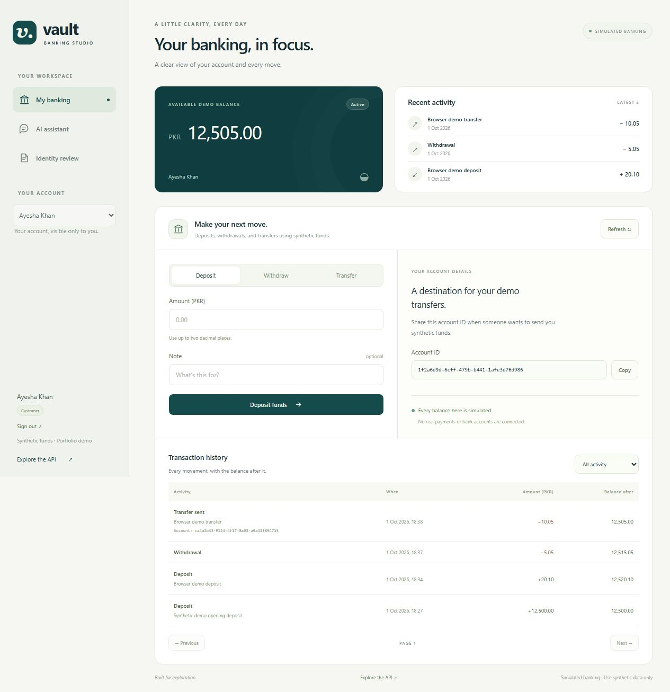
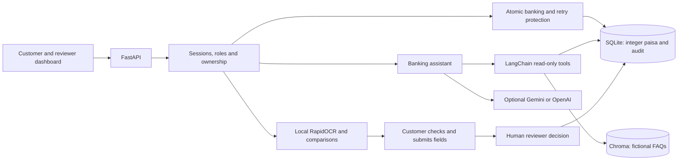

# Vault — Mini Core Banking + AI

A local portfolio project combining an authenticated FastAPI banking API, a
read-only banking assistant, and an OCR-assisted KYC submission and review flow.
The responsive dashboard is served by FastAPI: no separate frontend build is
required. Open `/demo` for the application or `/docs` for interactive API docs.

All balances, identities and policies are synthetic. This project demonstrates
banking-domain engineering; it does not connect to a bank or to Temenos.



[Animated screenshot walkthrough](artifacts/demo-walkthrough.gif) ·
[Demo and publishing guide](DEMO_GUIDE.md) · [Validation evidence](VALIDATION.md)

The previous full-suite run passed **135 tests**; the latest Gemini reliability
update passed **40 targeted assistant tests**. The customer, assistant, OCR and
reviewer workflows were also exercised in the desktop/mobile browser.

## Delivered features

- **Banking:** account creation with an atomic opening deposit, exact paisa
  storage, coordinated balance updates, deposits, withdrawals, transfers, and
  transaction history with pagination, type filters and API date filters.
- **Access controls:** customer registration, password hashing, revocable
  sessions, customer account ownership, and a separate KYC reviewer role.
- **Retry protection:** persisted idempotency keys for deposits, withdrawals and
  transfers. An identical retry replays the original receipt; changed request
  data with the same key is rejected.
- **Assistant:** authenticated balance/history tools and cited answers from eight
  fictional FAQs in ChromaDB. LangChain defines the read-only tools. A keyless
  local mode works immediately; Gemini and OpenAI integrations are optional.
- **KYC:** local image/text extraction, field comparisons, editable submissions,
  reviewer approval or rejection with a reason, rejected-record resubmission,
  and an audit history visible to the account owner and reviewer.
- **Dashboard:** sign-in/registration, account opening, money forms, paginated
  history, assistant chat, OCR analysis, KYC submission/status/history, and a
  reviewer queue with decision forms.

## Run locally

Use Python 3.12. For a fresh checkout on Windows:

```powershell
py -3.12 -m venv .venv
.\.venv\Scripts\python.exe -m pip install -r requirements-dev.txt
if (-not (Test-Path .env)) { Copy-Item .env.example .env }
.\.venv\Scripts\python.exe -m app.seed_demo
.\.venv\Scripts\python.exe -m uvicorn app.main:app --host 127.0.0.1 --port 8000 --reload
```

On this machine, the virtual environment and dependencies already exist. Run
these commands from the project folder:

```powershell
Set-Location 'C:\Users\m10ah\Documents\ChatGPT\Systems project\core-banking-api'
.\.venv\Scripts\python.exe -m app.seed_demo
.\.venv\Scripts\python.exe -m uvicorn app.main:app --host 127.0.0.1 --port 8000 --reload
```

Open [the local dashboard](http://127.0.0.1:8000/demo). Use `--port 8001` if another
server already occupies port 8000. Calling the virtual environment's Python
avoids activation and PowerShell execution-policy changes.

On Linux/macOS, create the environment with `python3 -m venv .venv`, then use
`.venv/bin/python` instead of `.\.venv\Scripts\python.exe`.

The seed command creates these synthetic accounts without resetting existing
passwords, balances or transaction history:

| Role | Email | Initial balance in a new database |
| --- | --- | --- |
| Customer: Ayesha Khan | `ayesha.customer@example.com` | PKR 12,500.00 |
| Customer: Hassan Ali | `hassan.customer@example.com` | PKR 2,500.00 |
| Reviewer | `reviewer@example.com` | No banking account |

The shared demo password is **`VaultDemo!2026`**. Public registration creates
customers only; the seed command provisions the demo reviewer.

## Walk through the demo

1. Sign in as Ayesha. Make a small deposit or withdrawal and inspect the updated
   balance and transaction history.
2. Sign in as Hassan in another browser/session, copy his account ID, and use it
   as the recipient of an Ayesha transfer. The sender gets a receipt for their
   own account; the recipient sees the incoming entry in their own history.
3. Ask **What's my balance?**, **Show my last 5 transactions**, and
   **What documents do I need for KYC?**. Account answers use current database
   values; FAQ answers include their sources.
4. In Document review, upload `samples/demo-id.png` with expected ID
   `42101-1234567-1`. Inspect the extracted fields, correct them if necessary,
   and submit for review. Try `samples/mismatched-id.txt` to see mismatch flags.
5. Sign in as the reviewer. Open the pending submission and approve or reject
   it with a reason. Sign back in as Ayesha to see the decision and audit.
   A rejected submission can be corrected and resubmitted.

The sample files are visibly invalid synthetic IDs. Reviewer decisions concern
submitted text fields: uploaded images are processed locally and are not retained.

## Money and request contracts

The database stores whole **paisa as integers**, never binary floating-point
amounts. The API returns monetary values as **two-decimal strings**, such as
`"12500.00"`. Send decimal strings to preserve the intended value. Values with
more than two fractional digits, non-finite amounts, nonpositive transaction
amounts and amounts beyond the supported bound are rejected.

Every deposit, withdrawal and transfer needs an **`Idempotency-Key`** header.
Use one new key for a new intended action and keep the same key and payload when
retrying that action after an uncertain network result. Keys are scoped to the
signed-in user and persisted with the completed transaction.

```http
POST /accounts/{account_id}/deposit
Content-Type: application/json
Idempotency-Key: demo-deposit-001
Cookie: vault_session=<session issued by login>

{"amount":"25.50","note":"Synthetic demo deposit"}
```

An identical retry returns the saved receipt without moving money again. Reusing
that key for different request data returns HTTP 409. Missing keys return HTTP
400. Opening an account and recording its initial deposit commit together.

Transfers record both ledger-like history entries internally, but their response
contains only the sender's receipt; it never exposes the recipient's balance.
These entries are transaction history, not a complete double-entry ledger.

## Authentication and KYC

Registration and login issue an opaque `vault_session` cookie with `HttpOnly`
and `SameSite=Strict`; the database stores a hash of the session token. Sessions
expire and can be revoked by logout. Passwords use salted PBKDF2 hashing.
Account reads, history, money actions, assistant tools and document analysis
require a customer session and enforce account ownership in the backend.

A KYC analysis returns `ready_for_review` or `review_required`. Neither approves
KYC or proves document authenticity. Analysis does not create or change a KYC
record. The customer explicitly submits checked text fields for review.

Only a reviewer can approve or reject a pending submission. A reason is required;
the decision, reviewer, time and audit entry persist together. The review request
must include `expected_submitted_at`, using the `submitted_at` value from the
submission the reviewer actually opened. Duplicate or stale reviews return HTTP
409; a missing version returns 422. Rejected submissions can be resubmitted while preserving
earlier review decisions. Pending and verified records cannot be overwritten by
customer resubmission.

| Method | Route | Purpose |
| --- | --- | --- |
| POST | `/auth/register`, `/auth/login` | Customer registration or session sign-in |
| GET | `/auth/me` | Current signed-in identity and role |
| POST | `/auth/logout` | Revoke the current session |
| POST / GET | `/accounts/` | Open an account / list owned accounts |
| GET | `/accounts/{account_id}` | Owned account and balance |
| POST | `/accounts/{account_id}/deposit`, `/accounts/{account_id}/withdraw` | Simulated money actions |
| POST | `/transfer` | Transfer from an owned account; sender receipt only |
| GET | `/accounts/{account_id}/transactions` | Owned history: `limit`, `offset`, `type`, `from_date`, `to_date` |
| GET | `/assistant/status` | Mode and configured-key presence; no live provider check |
| POST | `/assistant/chat` | Read-only account tools and cited FAQ answers |
| POST | `/kyc/{account_id}/analyze-document` | Local OCR and comparisons |
| POST / GET | `/kyc/{account_id}` | Submit checked fields / read KYC status |
| GET | `/kyc/reviews/pending` | Reviewer-only pending queue |
| PATCH | `/kyc/{account_id}/verify` | Reviewer decision: `approve`, `reason`, `expected_submitted_at` |
| GET | `/kyc/{account_id}/reviews` | Owner/reviewer audit history |

Chat accepts `message`, an optional owned `account_id`, and up to 12 history
messages using `user` or `assistant` roles. Its response contains `reply`, `mode`,
`sources`, `tools_used`, and `account_id`. Tool arguments cannot select another
account, and the assistant has no money-movement or KYC-approval tools.

Document analysis uses multipart `file` and optional `expected_id_number`.
The expected ID takes precedence over a previously submitted KYC ID; without
either, the response explicitly reports that an ID comparison is unavailable.

## AI modes and local processing

The default **`AI_MODE=demo` is rule-based, not an LLM**. It exercises real
read-only account tools and FAQ retrieval without a key or provider request.
It handles the sample intents rather than general conversation.

When ready to connect Gemini, put the key in your private `.env`, set the mode,
and restart the server:

```dotenv
AI_MODE=gemini
GEMINI_API_KEY=your-key
GEMINI_MODEL=gemini-3.5-flash-lite
```

The setup uses [Gemini 3.5 Flash-Lite](https://ai.google.dev/gemini-api/docs/models/gemini-3.5-flash-lite),
which has a [free tier](https://ai.google.dev/gemini-api/docs/pricing).
[Older 2.5 models](https://ai.google.dev/gemini-api/docs/deprecations) are
restricted to previously active projects.

Manage the key and your provider project's quota/billing settings in
[Google AI Studio](https://aistudio.google.com/apikey). The app cannot establish
your billing tier from a key. Gemini calls use Google's compatible endpoint
through the installed OpenAI SDK; Gemini mode does not call OpenAI. There is no
automatic provider fallback. Optional OpenAI configuration uses `AI_MODE=openai`,
`OPENAI_API_KEY` and `OPENAI_MODEL` from `.env.example`.

Only chat/history and selected read-tool results reach an enabled model provider.
KYC images stay local. Provider integration tests use mocked HTTP. A live Gemini
balance lookup, cited KYC FAQ answer, and last-five-transactions lookup passed
on October 1 and again on October 2, 2026. Intermittent TLS connection errors
were observed on October 1. The
assistant now retries one connection-setup failure per chat with a short delay;
it does not retry timeouts, HTTP errors or quota failures, and keeps TLS
certificate verification enabled. See `VALIDATION.md` for verification scope.
OpenAI has not been tested against a live provider.
The `configured` badge confirms key presence. `Connected` reflects the last
successful chat; failed requests update it to unavailable, timed out or quota
reached. None of these states establishes the Google project's billing tier.

Chroma indexes eight fictional FAQs with deterministic hashed word-count
vectors. This is **lexical retrieval**, not pretrained semantic embeddings.
No embedding model download is needed. LangChain supplies the read-only tools.

RapidOCR/ONNX performs local OCR, followed by labelled-field extraction and
normalized comparisons. PNG, JPEG and WEBP are validated with limits of 5 MB
and 12 million pixels; UTF-8 TXT samples also work. Low confidence, missing fields
and mismatches trigger review flags. OCR uses a timeout and one active worker;
the first image request may take several seconds while models load.

## Database, migration and deployment preparation

`DATABASE_URL` selects the database. The default is the project's `banking.db`;
for a persistent container path use `sqlite:////data/banking.db`.

Startup runs the versioned migration in `app/migrations.py`. A legacy SQLite
v1 database is backed up under `.data/backups/` next to that database before
conversion. Existing float values are rounded to paisa during migration, and
original IDs/history are retained. **Legacy accounts remain unowned:** registering
a matching email does not claim them. The synthetic seed uses separate customer
emails and does not attach or reset legacy accounts.

For local HTTP use `DEMO_MODE=true` and `COOKIE_SECURE=false`. For public HTTPS
set `DEMO_MODE=false` and `COOKIE_SECURE=true`, use persistent storage, and keep
secrets in server environment variables. Demo seeding is disabled when demo mode
is false. The app is intended to remain a synthetic portfolio demonstration.

`Dockerfile` and `compose.yaml` are prepared, with a named volume storing the
SQLite database and Chroma index. **The Docker image has not been built or run
here because Docker is unavailable.** On a machine with Docker, the intended
local sequence is:

```bash
docker compose up --build -d
docker compose exec vault python -m app.seed_demo
```

Compose binds port 8000 to localhost and explicitly uses local demo settings.
Do not remove its data volume if you want to retain demo state. PostgreSQL needs
an appropriate driver and database-specific migration/concurrency validation;
no PostgreSQL run or public deployment has been verified.

## Architecture



## Verification

Run every regression suite:

```powershell
.\.venv\Scripts\python.exe -m unittest discover -s tests -v
```

The suites cover ordinary banking workflows, exact-money validation, concurrent
money actions, rollback behavior, persisted retries, customer/reviewer access,
KYC audit and resubmission, versioned migration, assistant tool scope, provider
error handling and document extraction. `tests/test_known_gaps.py` now retains
the original defects as regression checks; it is not an intentional-failure suite.

Tests use temporary databases and synthetic identities. Provider tests make no
live model calls, and the OCR suite includes extraction from the real sample PNG.
A passing local suite does not establish PostgreSQL, live-provider or deployment
behavior. See [the historical baseline review](REVIEW.md) for the original issues
and how the October 1 implementation addresses them.

## Scope and remaining limits

This is a single-currency PKR simulation with no payment network, Temenos
integration or full double-entry general ledger. OCR extracts text; it does not
authenticate an identity document. It has no external identity verification.
Live Gemini balance, FAQ and transaction-history replies were observed, but
consistent connectivity is not established. OpenAI, PostgreSQL, Docker execution
and public hosting remain unverified. Dependency compatibility checks are not a
vulnerability audit.

## Project layout

```text
app/
  main.py                  # Routes, same-origin controls and dashboard
  auth.py                  # Password hashing, sessions, roles and ownership
  database.py              # DATABASE_URL, sessions and migration startup
  migrations.py            # Backed-up SQLite v1 -> v2 conversion
  models.py, schemas.py     # ORM records and validated API contracts
  money.py                 # Exact paisa conversion and amount bounds
  seed_demo.py             # Explicit synthetic customers and reviewer
  assistant_service.py     # Demo intents, retrieval, tools and model loops
  kyc_service.py           # Validated OCR, extraction and comparisons
  knowledge/               # Eight fictional banking FAQs
  routers/                 # Auth, banking, assistant, KYC and review APIs
  static/                  # Dashboard HTML, CSS and JavaScript
samples/                   # Visibly invalid synthetic IDs and generator
tests/                     # Isolated workflow and safeguard regressions
.env.example               # Local configuration template; keep .env private
requirements.txt           # Runtime dependencies
requirements-dev.txt       # Runtime dependencies plus test client
Dockerfile, compose.yaml   # Prepared container setup and persistent volume
REVIEW.md                  # Historical starter review and current resolution
```
